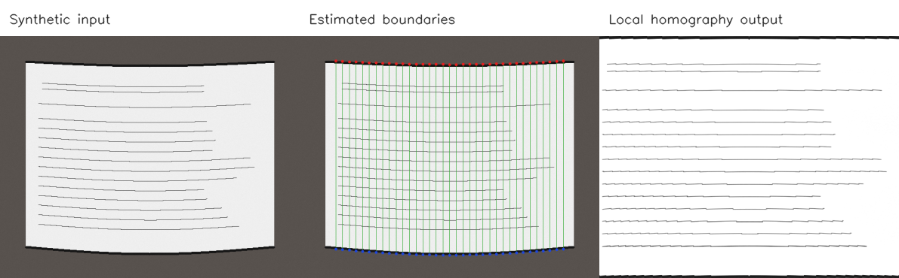

# Book Page Dewarping with OpenCV

**Classical computer vision | Python | OpenCV | Spline interpolation | Piecewise homography**

An academic image-processing project for flattening photographed curved book pages. It estimates the page's upper and lower boundaries, lets users adjust the detected points, and uses local perspective transformations to assemble a flattened page. An optional grayscale postprocessing step reduces broad lighting variations.

This repository is a cleaned version of my original Computer Graphics midterm project. The original work used a single OpenCV notebook and manual point adjustment. The implementation here separates detection, geometry, and image correction so each component can be tested and reused.

> **Source availability:** The original photograph (`DewarpBook.jpg`) was not included in the saved project archive. The provided preview uses **synthetic geometry and fictional line patterns**, not a real book scan. No validated result on real-world documents is claimed for the refactored code.



*All three panels use programmatically generated test data. The original academic result is not reproduced here.*

## What it does

1. **Detect boundaries:** Canny edge detection identifies candidate top/bottom boundaries; cubic splines smooth the sampled control points.
2. **Review points:** Save an overlay or launch an optional OpenCV desktop editor to drag control points. Right-drag pans and the scroll wheel zooms.
3. **Dewarp:** Split the page into strips and horizontal cells. Estimate a homography for each quadrilateral and combine locally warped tiles.
4. **Correct shading:** Divide the grayscale result by a blurred background estimate to reduce gradual illumination changes.

## Run the synthetic demonstration

Requires Python 3.10 or later. From the repository root:

```bash
python -m venv .venv
# Linux/macOS: source .venv/bin/activate
# Windows PowerShell: .venv\Scripts\Activate.ps1
pip install -r requirements.txt

python scripts/generate_demo.py
python -m dewarp.cli --input data/demo/synthetic_curved_page.png \
  --output outputs/demo_flat.png --overlay outputs/demo_points.png \
  --save-points outputs/demo_points.json
```

On PowerShell, enter the CLI command on one line instead of using `\` continuation.

## Run on your own photograph

```bash
python -m dewarp.cli --input data/raw/my_page.jpg \
  --output outputs/my_page_flat.png \
  --overlay outputs/my_page_points.png \
  --save-points outputs/my_page_points.json
```

Inspect `outputs/my_page_points.png`. The automatic method is a heuristic and can misidentify edges, especially where text or background lines are prominent. For desktop use, add `--interactive` to correct point locations before generating the image.

To reuse a saved correction:

```bash
python -m dewarp.cli --input data/raw/my_page.jpg \
  --points outputs/my_page_points.json --output outputs/my_page_flat.png
```

The OpenCV GUI requires a local graphical desktop. All automated tests and the noninteractive CLI work without a display.

To run the Jupyter walkthrough, install `requirements-notebook.txt` and open `notebooks/walkthrough.ipynb` with JupyterLab.

## Testing

```bash
pip install -r requirements-dev.txt
python -m pytest -q
```

GitHub Actions also runs the synthetic demonstration headlessly.

## Repository structure

```text
book-page-dewarping/
├── README.md
├── dewarp/
│   ├── boundaries.py      # Edge points, spline smoothing, annotations
│   ├── editor.py          # Optional interactive OpenCV point editor
│   ├── transform.py       # Local homography and shading correction
│   └── cli.py             # Batch and interactive command-line modes
├── scripts/
│   └── generate_demo.py
├── data/demo/             # Synthetic image for demonstration
├── docs/
│   ├── demo_comparison.png
│   └── technical_notes.md
├── notebooks/
│   └── walkthrough.ipynb
├── legacy/
│   └── mid_original.ipynb # Archived original notebook; requires missing input
├── tests/
├── requirements*.txt
└── .github/workflows/tests.yml
```

## Limitations and history

The original academic exercise used CLAHE, adaptive thresholding, Canny edges, spline interpolation, manual control-point correction, and piecewise homography. Those are the foundation for this implementation, with some changes for testability and memory efficiency. The original notebook cannot run unchanged because the input photograph was not preserved. A transformed JPEG and the project report were supplied for review but not redistributed in this repo due to the unknown rights for the photographed textbook material.

For the details of the changes and known limitations, see [technical notes](docs/technical_notes.md).
